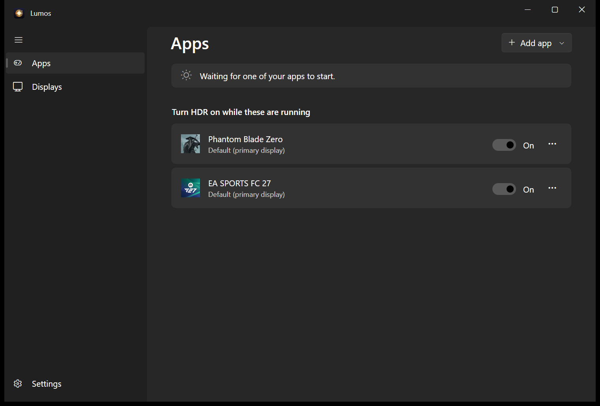

<p align="center"></p>

<h1 align="center">Lumos</h1>

<p align="center"><b>Automatic HDR, per app, for Windows 11.</b></p>

<p align="center">
  <a href="https://github.com/joao-penim/Lumos/releases/latest"></a>
  <a href="https://github.com/joao-penim/Lumos/actions/workflows/ci.yml"></a>
  <a href="LICENSE"></a>
</p>

Keep your desktop in SDR. When a game or app on your list starts, Lumos turns HDR on. It stays on through alt-tab, and when the app closes Lumos turns it back off. You no longer need to remember **Win + Alt + B** before launching a game, then restart it when you forget.

Lumos turns real HDR on and off. It is *not* Windows Auto HDR, which converts SDR content to HDR.

<p align="center"></p>

## Features

- **Per-app HDR**: add any game or app by browsing for its `.exe` or picking it from the running apps.
- **Alt-tab safe**: HDR follows the app while it runs, not which window has focus.
- **Restores your setup**: Lumos only turns HDR off if Lumos turned it on. If HDR was already on, or you switch it off yourself, Lumos leaves it alone.
- **Several apps at once**: HDR stays on until the last one closes.
- **No flicker on restarts**: a short grace delay (3 s by default) covers launchers and anti-cheat that restart the game.
- **Launch with HDR**: desktop shortcuts that turn HDR on *before* the game starts, for games that only check HDR at startup. Works with Steam links such as `steam://rungameid/…`.
- **Pick the display**: primary display (default), all HDR displays, or a specific monitor, per app.
- **Crash-safe**: if Lumos is closed unexpectedly while HDR is on, it restores SDR on its next start. It also restores SDR when you sign out or shut down.
- **Feather-light**: the background agent uses no CPU while idle and about 8 MB of memory.
- **Feels native**: Windows 11 Fluent design that follows your light/dark theme and accent color.

## Requirements

- Windows 11, with HDR available in **Settings → System → Display**. Windows 10 may work but isn't tested.
- A display that supports HDR.
- Nothing else: the download includes everything it needs. No separate .NET install is required.

## Install

1. Download `Lumos-<version>-win-x64.zip` from the [latest release](https://github.com/joao-penim/Lumos/releases/latest).
2. *(Recommended)* [Verify the download](#verify-your-download).
3. Extract it to a permanent folder, for example `%LOCALAPPDATA%\Programs\Lumos`, and run **`Lumos.exe`**.

Lumos isn't code-signed yet, so on first run Windows SmartScreen may say *"Windows protected your PC"*. Choose **More info → Run anyway**. Verifying the download is how you know the file is genuine.

### Verify your download

Every release is built by GitHub Actions directly from the source code in this repository.

**Checksum**: confirms the file wasn't corrupted or swapped. The result must match `SHA256SUMS.txt` on the release page:

```powershell
Get-FileHash .\Lumos-0.1.0-win-x64.zip -Algorithm SHA256
```

**Build provenance**: confirms the file was built by this repository's release workflow, and from which commit. It needs the [GitHub CLI](https://cli.github.com/):

```powershell
gh attestation verify .\Lumos-0.1.0-win-x64.zip --repo joao-penim/Lumos
```

This also works on `Lumos.exe` and `LumosAgent.exe` after extracting.

## Usage

1. Open **Lumos** and go to **Apps → Add app**.
2. Choose the game's `.exe`, or pick it from the apps that are running right now.
3. That's it. Start the game normally and HDR turns on. Close it and HDR turns back off.

In **Settings** you can turn on **Start with Windows**, choose the default display, change the grace delay, or pause Lumos.

Lumos lives in the notification area (system tray):

- **Gold icon**: Lumos has HDR on.
- **Grey icon**: waiting for one of your apps.
- **Orange pause bars**: Lumos is paused.

Left-click the icon to open Lumos. Right-click it to see the running apps, or to pause or exit.

**Tip:** if a game shows up washed out or in SDR, it probably checks HDR the moment it starts. Use **⋯ → Create desktop shortcut** for it, and start the game from that shortcut.

## FAQ

**Is it safe to use with anti-cheat games?**
Lumos never touches game processes: no injection, no reading game memory, no overlays. It notices when a game's window appears and changes the same Windows display setting as Win + Alt + B.

**Why does Windows warn me when I open it?**
The app isn't code-signed yet, which costs money. SmartScreen warns about any new unsigned app. See [Verify your download](#verify-your-download) to confirm your copy is genuine.

**A game isn't detected. What can I check?**
- Make sure its toggle is on.
- Make sure the path matches the exe the game actually runs. Some launchers start a different exe. Try *Choose from running apps* while the game is open.
- Games running as administrator haven't been tested yet.

If it still doesn't work, please [open an issue](https://github.com/joao-penim/Lumos/issues/new/choose) and attach `%APPDATA%\Lumos\agent.log`.

**Where are my settings?**
In `%APPDATA%\Lumos`: `settings.json` holds your apps and preferences, and `agent.log` is a small log for troubleshooting.

## Uninstall

1. In **Settings**, turn off **Start with Windows**.
2. Right-click the tray icon and choose **Exit**.
3. Delete the Lumos folder, and `%APPDATA%\Lumos` if you don't want to keep your settings.

## Roadmap

- Code signing, so Windows stops showing the SmartScreen warning
- `winget install Lumos`
- Linux support (KDE Plasma / GNOME). The core logic is already platform-independent.

Ideas and feedback are welcome in [Issues](https://github.com/joao-penim/Lumos/issues).

## Contributing

Bug reports, ideas and pull requests are welcome. See [CONTRIBUTING.md](CONTRIBUTING.md) for how to build Lumos from source and how the code is organized.

## License

[MIT](LICENSE) © João Penim
